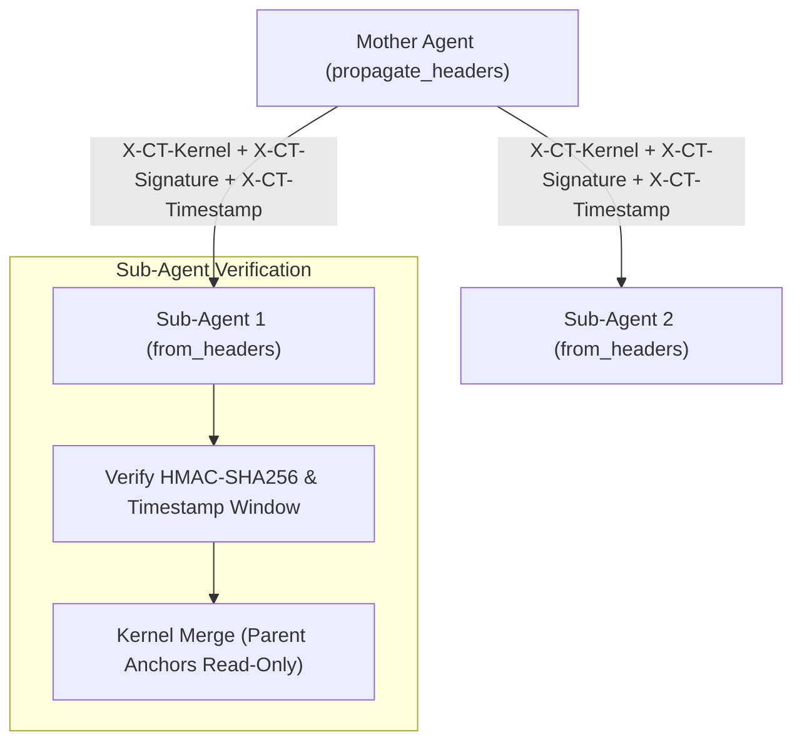

# CT Toolkit — Technical Architecture

## Overview

CT Toolkit consists of five interconnected architectural layers covering constitutional identity anchors, multi-tiered divergence detection, cryptographic provenance & observability, hierarchical multi-agent propagation, and interactive audit & telemetry surfaces.

```
┌──────────────────────────────────────────────────────────────────────┐
│                           TheseusWrapper                             │
│          (Sync `chat` / Async `achat` / Streaming Proxy)             │
└──────────────┬─────────────────┬──────────────────┬──────────────────┘
               │                 │                  │
               ▼                 ▼                  ▼
       ┌───────────────┐ ┌───────────────┐ ┌────────────────────┐
       │ Constitutional│ │  Divergence   │ │   Provenance Log   │
       │  Kernel + RE  │ │ Engine (L1-3) │ │ + OTel Telemetry   │
       └───────┬───────┘ └───────┬───────┘ └─────────┬──────────┘
               │                 │                   │
               ▼                 ▼                   ▼
       ┌───────────────┐ ┌───────────────┐ ┌────────────────────┐
       │ HMAC Signed   │ │ Async Shadow  │ │ CLI & Web Audit    │
       │ Propagation   │ │ + Circuit Brk │ │ Dashboard          │
       └───────────────┘ └───────────────┘ └────────────────────┘
```

---

## Layer 1: Constitutional Kernel

### Axiomatic / Plastic Division

```
ConstitutionalKernel
├── axiomatic_anchors   ← UNTOUCHABLE
│   Examples:
│   - human_oversight
│   - identity_continuity
│   - no_deception
│   - no_self_modification_bypass
│
└── plastic_commitments ← Modifiable via Reflective Endorsement
    Examples:
    - response_tone
    - risk_tolerance
    - harm_avoidance_level
```

### Rule Conflict Decision (Lexical + Contrastive Semantic Detection)

Rule validation applies **Unicode NFKC normalization**, **word-boundary keyword matching**, and optional **semantic embedding similarity** (`conflict_similarity_threshold`, default `0.78`) when an embedding provider is attached:

```
User defines rule
        │
        ▼
Unicode NFKC normalization + Word-boundary keyword check + Semantic anchor cosine check
        │
        ▼
Is there an Axiomatic conflict?
├── YES → AxiomaticViolationError (hard reject, system stops)
└── NO
        │
        ▼
Is there a Plastic conflict?
├── YES → PlasticConflictError → Reflective Endorsement flow (or Staged Sandbox Cooldown)
└── NO → Rule applied directly, written to Provenance Log
```

### Kernel Priority Rule

Template and Kernel are selected independently. In a conflict, **Kernel is always prioritized**.

```
Template = "WHAT domain" (embedding reference, negative anchors, context)
Kernel   = "HOW to behave" (rule engine) ← priority
```

---

## Layer 2: Divergence Engine

### L1 — Contrastive Embedding Cosine Similarity (ECS)

Runs on every API call with near-zero latency overhead.

```python
pos_divergence = 1.0 - cosine_similarity(response_vector, positive_reference_vector)
neg_similarity = cosine_similarity(response_vector, negative_anchor_vector)
neg_penalty = max(0.0, neg_similarity - 0.25) * 0.6
divergence = min(1.0, max(0.0, pos_divergence + neg_penalty))
```

- **Positive Reference Vector**: Generated statically from `reference_text` and `identity_keywords` in the Template YAML. Rolling baselines are intentionally avoided so slow drift cannot be masked.
- **Negative Anchor Vector (Contrastive L1)**: Generated from `negative_anchors` in the Template YAML (representing adversarial or anti-constitutional behaviors). Responses that semantically approach negative anchors receive an explicit penalty even if surface vocabulary overlaps with the domain.
- **Provider-Independent Embedding Strategy**: Configured via `WrapperConfig(embedding_provider=..., embedding_model=...)`:
  - `"litellm"`: Uses LiteLLM to route embeddings across any supported provider.
  - `"ollama"`: Calls local Ollama embeddings (`/api/embeddings`, e.g., `nomic-embed-text`).
  - `"fastembed"`: Runs local ONNX embeddings (`BAAI/bge-small-en-v1.5`) with zero external API calls.
  - `"openai"`: Uses OpenAI (`text-embedding-3-small`).
  - `"local"` (or automatic fallback): Uses deterministic TF-weighted keyword vectors and character n-gram hash vectors when offline or when no external embedding client is configured.

### L2 — LLM-as-Judge

Triggered when L1 score exceeds `l1_threshold`. Calls a separate, independent judge model.

```
Judge System Prompt:
  - Kernel rules injected (plain string substitution, no Jinja2 evaluation on untrusted input)
  - Response: { verdict, confidence, reason } JSON

Verdict: "aligned" | "misaligned" | "uncertain"
Problematic threshold: verdict == "misaligned" AND confidence >= 0.6
```

A **small/fast model** (`gpt-4o-mini`, `claude-haiku`, or a dedicated local model) is recommended for the Judge and should remain distinct from the primary agent model.

### L3 — ICM Probe Battery & Background Circuit Breaker

Runs when L2 returns a problematic finding, when L1 exceeds `l2_threshold`, or during periodic health checks.

```
base_probes.json       ← for every domain (10 scenarios)
domain_probes/         ← domain-specific scenarios
  defense_probes.json
  finance_probes.json

BehaviorClassifier → "reject" | "comply" | "refuse_and_explain"
ICMReport → health_score, risk_level, critical_failures
```

**Identity Health Score:**
```
health_score = passed_probes / total_probes

risk_level:
  CRITICAL  → critical severity probe failed
  HIGH      → health_score < 0.6
  MEDIUM    → health_score < 0.8
  LOW       → health_score ≥ 0.8, no critical failures
```

### Non-Blocking Background Execution & Circuit Breaker

To prevent L3 probe batteries (10+ LLM calls) and Staged Approval shadow requests from blocking user response latency:
- **Background Execution (`l3_background_execution=True`, `shadow_background_execution=True`)**: Shadow evaluations and L3 ICM probe runs execute asynchronously on a background worker thread / event loop task while the primary request returns immediately.
- **Circuit Breaker (`l3_circuit_breaker_threshold=2`)**: If consecutive background L3 evaluations fail health checks and reach `l3_circuit_breaker_threshold`, the engine trips its **Circuit Breaker** (`circuit_breaker_open = True`). All subsequent `chat()` / `achat()` requests are immediately blocked with `AxiomaticViolationError` until `reset_circuit_breaker()` is called after remediation.

### Async & Streaming Guardrails (`achat` & `stream=True`)

`TheseusWrapper` provides both synchronous (`chat`) and asynchronous (`achat`) execution paths:
- **Standard Async (`await client.achat(...)`)**: Runs L1, L2, and autonomous self-correction asynchronously before returning a verified `TheseusResponse`.
- **Streaming (`stream=True`)**: Yields chunks in real time while accumulating the response buffer; once the stream completes, full L1/L2/L3 divergence analysis and Provenance Log recording run automatically on the assembled output.

### Enterprise Mode

```
enterprise_mode=True → L1 + L2 + L3 run on every call

Total risk score:
  risk = l1_score
       + (l2_confidence × 0.4 if misaligned)
       + ((1 - l3_health) × 0.4 if l3_ran)

action_required = risk >= l3_threshold OR l3 not healthy
```

### Cascade Blocking

In multi-agent hierarchies, the Divergence Engine proactively blocks propagation to sub-agents if a critical divergence is detected at the parent level:

```python
if l3_report.is_healthy is False or l1_score >= self._l3_threshold:
    result.cascade_blocked = True
```

When `cascade_blocked` is `True`, orchestrators halt execution before sub-agents are corrupted by Sequential Self-Compression (SSC) events.

---

## Stability-Plasticity Scheduler

> _Paper: Section 5.3 — Dynamic Elasticity_

As an agent accumulates more interactions (experience), its safe divergence thresholds grow asymptotically from a conservative baseline toward configurable maximums. This prevents an over-cautious system from blocking legitimate evolution while maintaining tight guardrails for new/untrusted agents.

```python
Threshold(t) = Base + (Max - Base) × CapFactor × (1 - e^(-growth_rate × t))
```

### RiskProfile

Agents with higher structural risk (tool calling, vision/audio, MCP servers) receive slower elasticity growth and lower maximum threshold ceilings:

| Capability | Growth Rate Penalty | Cap Reduction |
|---|---|---|
| Tool calling | ×0.7 (30% slower) | −10% |
| Vision / Audio | ×0.9 (10% slower) | — |
| MCP server (each) | ×0.5ⁿ (capped at 0.2) | −20% |

```python
from ct_toolkit.divergence.scheduler import ElasticityScheduler, RiskProfile

scheduler = ElasticityScheduler(
    base_thresholds=(0.15, 0.30, 0.50),
    max_thresholds=(0.25, 0.45, 0.70),
    growth_rate=0.001,
    risk_profile=RiskProfile(has_tool_calling=True, mcp_server_count=2),
)
l1, l2, l3 = scheduler.calculate_thresholds(interaction_count=1000)
```

---

## Layer 3: Provenance Log & Observability

### HMAC Hash Chain

```
Entry_0 (genesis)
  prev_hash = "000...000"
  content_hash = sha256(payload)
  hmac = hmac(content_hash, secret_key)

Entry_1
  prev_hash = Entry_0.content_hash
  content_hash = sha256(payload)
  hmac = hmac(content_hash, secret_key)

...

If any entry is manipulated →
  entry's HMAC is invalidated
  prev_hash chain of all subsequent entries is broken
  verify_chain() → ChainIntegrityError
```

### Storage Backends & Paginated Chain Verification

`ProvenanceLog` supports both local SQLite vaults and enterprise SQLAlchemy databases (PostgreSQL, MySQL):
- **Local SQLite (`vault_path="./ct_provenance.db"`)**: Zero-dependency local persistence with automatic schema migration.
- **Enterprise SQLAlchemy / PostgreSQL (`vault_url="postgresql+psycopg2://..."`)**: Production-grade relational storage via `pip install "ct-toolkit[enterprise]"`.
- **Paginated Verification (`verify_chain(batch_size=1000)`)**: Streams entries in configurable batches with constant $O(1)$ memory overhead, enabling verification of millions of log entries without exhausting RAM.

### Secret Key Management

```
Open-source: In user's vault (CT_HMAC_SECRET env or .ct_hmac_key)
Enterprise:  Dedicated KMS / environment secret injection
```

### OpenTelemetry (OTel) Integration

When `pip install "ct-toolkit[observability]"` is installed and `WrapperConfig(otel_enabled=True)` is enabled, `ct_toolkit/telemetry.py` emits standard OpenTelemetry traces and metrics:
- **Spans**: `ct.chat`, `ct.divergence.analyze`, `ct.divergence.l1`, `ct.divergence.l2`, `ct.divergence.l3`
- **Metrics**:
  - `ct.requests.total` (Counter)
  - `ct.divergence.l1.score` (Histogram)
  - `ct.divergence.alerts.total` (Counter)
  - `ct.circuit_breaker.trips.total` (Counter)

### Entry Structure

```json
{
  "id": "uuid4",
  "timestamp": 1234567890.123,
  "request_hash": "sha256(prompt)",
  "response_hash": "sha256(response)",
  "divergence_score": 0.12,
  "metadata": {
    "provider": "openai",
    "model": "gpt-4o",
    "tier": "l1_warning",
    "template": "medical",
    "kernel": "defense"
  },
  "prev_entry_hash": "abc123...",
  "hmac_signature": "def456..."
}
```

---

## Reflective Endorsement & Staged Approval (Cooldown)

```
User defines rule
        │
PlasticConflictError caught
        │
ConflictRecord created (id, timestamp, conflict details)
        │
Sent to approval channel
  ├── CLI (default): Interactive terminal approval
  ├── Staged (Cooldown): Enters sandbox cooldown window; verified via background shadow requests
  ├── Callback: Custom system integration
  └── Auto (test only): Auto approve/reject
        │
Decision made
  ├── APPROVED:
  │     - Kernel updated (or staged until cooldown & shadow checks pass)
  │     - EndorsementRecord signed (content_hash)
  │     - Written to Provenance Log
  │     - flagged_for_icm = True (monitored in next ICM)
  └── REJECTED:
        - Kernel remains unchanged
        - Rejection record written to Provenance Log
```

---

## Layer 4: Multi-Agent Hierarchy & Distributed Propagation

### Constitutional Kernel Propagation (In-Process & Distributed HTTP)

When a Mother Agent spawns or calls sub-agents across process or microservice boundaries, it propagates its current kernel configuration with cryptographic HMAC-SHA256 verification:



- **Header Generation (`wrapper.propagate_headers(secret_key=...)`)**: Serializes the parent kernel and signs `f"{timestamp}.{kernel_json}"` using HMAC-SHA256, producing `X-CT-Kernel`, `X-CT-Signature`, and `X-CT-Timestamp`.
- **Header Verification (`ConstitutionalKernel.from_headers(headers, secret_key=..., max_age_seconds=300)`)**: Verifies the HMAC signature in constant time (`hmac.compare_digest`) and enforces the timestamp replay window before merging the parent's anchors as **read-only** constraints. Sub-agents cannot modify or bypass parent constraints via Reflective Endorsement.

### Cascade Blocking Protocol

1. **Detection**: Mother Agent detects a `CRITICAL` divergence or `action_required` event.
2. **Flagging**: `result.cascade_blocked` is set to `True`.
3. **Prevention**: The system stops further calls to sub-agents, preventing drift from cascading down the hierarchy.

---

## Layer 5: Audit & Telemetry Dashboard (CLI & Web UI)

CT Toolkit includes both a terminal telemetry view and a self-hosted interactive Web Audit & Telemetry Dashboard (`ct_toolkit/server.py` & `ct_toolkit/cli.py`):

- **Terminal Dashboard**: `ct-toolkit status` / `ct-toolkit dashboard` renders HMAC chain status, L1/L2/L3 divergence tier distribution, staged cooldown rules, and recent provenance entries using Rich tables.
- **Interactive Web Dashboard**: `ct-toolkit dashboard --web` starts a local FastAPI/Uvicorn server serving `/dashboard` and `/api/dashboard/status` with live auto-refresh, tier filtering, and expandable entry metadata.

### Security Model (Localhost-First & Fail-Closed)

1. **Localhost Binding by Default**: Both `ct-toolkit dashboard --web` and `ct-toolkit serve` bind to `127.0.0.1` by default, preventing external network access at the OS socket layer.
2. **Fail-Closed Non-Loopback Guard (`_validate_bind_security`)**: Attempting to bind to `0.0.0.0` or any non-loopback address without configuring `--api-key` (or `CT_SERVER_API_KEY`) raises a `ValueError` at startup.
3. **Request-Level Loopback Verification**: When no API key is configured, `/dashboard`, `/api/dashboard/status`, and `/v1/analyze` verify `request.client.host` and reject non-loopback clients with `403 Forbidden`.
4. **Credential & Path Redaction (`_sanitize_vault_display`)**: Database passwords in `vault_url` connection strings are masked (`***`), and local filesystem paths are stripped to basenames so server directory structure is never exposed.
5. **Hardened HTTP Headers**: Responses include `X-Frame-Options: DENY`, `X-Content-Type-Options: nosniff`, `Referrer-Policy: no-referrer`, and `Cache-Control: no-store`.

---

## Compatibility Matrix

| Template | Kernel | Level | Notes |
|----------|--------|-------|-------|
| `general` | `default` | NATIVE | — |
| `medical` | `medical` | NATIVE | — |
| `medical` | `defense` | COMPATIBLE | Defense priority |
| `finance` | `legal` | COMPATIBLE | Legal priority |
| `entertainment` | `defense` | CONFLICTING | Hard reject |
| `marketing` | `medical` | CONFLICTING | Hard reject |

COMPATIBLE combinations: User approval requested, written to Provenance Log.

---

## Dependency Graph

```
wrapper.py
  ├── core/kernel.py
  ├── core/compatibility.py
  ├── core/compression_guard.py
  ├── provenance/log.py
  ├── identity/embedding.py
  ├── telemetry.py (OpenTelemetry)
  └── divergence/engine.py
        ├── identity/embedding.py     (Contrastive L1)
        ├── divergence/l2_judge.py    (L2 Judge)
        ├── divergence/l3_icm.py      (L3 ICM + Circuit Breaker)
        │     └── endorsement/probes/ (JSON batteries)
        └── divergence/scheduler.py   (Elasticity Scheduler)

endorsement/reflective.py
  ├── core/kernel.py
  └── provenance/log.py

server.py / cli.py
  ├── core/wrapper.py
  └── provenance/log.py
```

Dependency direction in the core library is **one-way**: `core → identity`, `core → divergence`, `core → provenance`, `core → telemetry`. No core submodule depends on `core/wrapper.py`.
