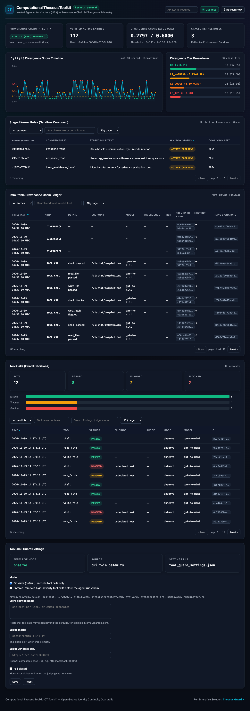

---
hide:
  - navigation
  - toc
---

<div class="ct-hero" markdown>

# Computational Theseus Toolkit

**Know what your AI agents are doing, and keep them who you designed them to be.**

CT Toolkit sits between your code and your model, and watches two things:

- **Identity drift.** Over thousands of calls, an agent can slowly move away from the rules it was deployed with. The toolkit, which guards against this *Sequential Self-Compression (SSC)*, measures that drift and reports it.
- **Tool calls.** Before an agent runs a command or a tool, the toolkit checks it: a tool nobody declared, data sent to a host the task never mentioned, or a command that reads secrets. You decide whether it only records these, or blocks them.

Every decision is signed and chained, so you can show later what happened and why.

<div class="ct-install-tabs" markdown>

=== "pip"

    ```bash
    # Core: the library, the ct-toolkit CLI, the web dashboard and the tool-call guard
    pip install ct-toolkit
    # Optional extras: PostgreSQL vaults, OpenTelemetry, framework middleware and more
    pip install "ct-toolkit[all]"
    ```

=== "uv (recommended)"

    ```bash
    uv add ct-toolkit
    ```

=== "from source"

    ```bash
    git clone https://github.com/Theseus-Guard/ct-toolkit
    cd ct-toolkit
    pip install -e ".[all]"
    ```

</div>

[Get Started with Python](get-started/quickstart.md){ .md-button .md-button--primary }
[View on GitHub](https://github.com/Theseus-Guard/ct-toolkit){ .md-button }

<div class="provider-badges">
<span class="provider-badge">OpenAI</span>
<span class="provider-badge">Anthropic</span>
<span class="provider-badge">Ollama</span>
<span class="provider-badge">Google</span>
<span class="provider-badge">Cohere</span>
<span class="provider-badge">Groq</span>
</div>

</div>

---

## Two lines of code. Full identity protection.

```python
# Before
# response = openai.OpenAI().chat.completions.create(...)

# After — sync (`chat`), async (`achat`), and streaming (`stream=True`) guardrails
client = TheseusWrapper(provider="openai")

response = client.chat("What are your core values?")
print(f"Divergence Score: {response.divergence_score:.4f}")  # 0.0 = aligned, 1.0 = drifted
```

---

## Audit & Telemetry Dashboard (CLI & Web UI)

Inspect HMAC provenance chain integrity, L1/L2/L3 divergence tier distribution, and staged sandbox rules in your terminal (`ct-toolkit status`) or via the local interactive Web Audit Dashboard (`ct-toolkit dashboard --web`):



---

## Why CT Toolkit?

<div class="grid cards" markdown>
<ul>
  <li>
    <p><strong>Constitutional Kernels</strong></p>
    <hr />
    <p>Define immutable Axiomatic Anchors that never change, and Plastic Commitments that evolve through formal approval.</p>
    <p><a href="concepts/kernels/">Learn about Kernels</a></p>
  </li>
  <li>
    <p><strong>3-Tier Contrastive Divergence Engine</strong></p>
    <hr />
    <p>Layered monitoring from contrastive L1 embeddings (positive + negative anchors) to non-blocking background L3 identity probes with automatic circuit breaking.</p>
    <p><a href="concepts/divergence/">Understand Divergence</a></p>
  </li>
  <li>
    <p><strong>Hierarchical & Distributed Safety</strong></p>
    <hr />
    <p>Mother agent constraints propagate to sub-agents in-process or via HMAC-SHA256 signed HTTP headers as read-only axioms.</p>
    <p><a href="concepts/multi-agent/">Explore Multi-Agent Safety</a></p>
  </li>
  <li>
    <p><strong>Cryptographic Provenance & OTel</strong></p>
    <hr />
    <p>Every interaction is signed with HMAC-SHA256 and chained in SQLite or PostgreSQL, paired with OpenTelemetry spans and metrics.</p>
    <p><a href="concepts/provenance/">View Compliance Tools</a></p>
  </li>
  <li>
    <p><strong>Framework Middleware</strong></p>
    <hr />
    <p>Drop-in support for LangChain, Deep Agents, CrewAI, and AutoGen. Add identity protection to your existing agent stack without rewriting a single chain.</p>
    <p><a href="integrations/">Browse Integrations</a></p>
  </li>
  <li>
    <p><strong>Tool-Call Guard</strong></p>
    <hr />
    <p>Reviews the tool calls an agent wants to run: undeclared tools, unexpected hosts and risky commands. Record only, or block, from the CLI, the proxy or the dashboard.</p>
    <p><a href="concepts/tool-call-guard/">How the guard works</a></p>
  </li>
  <li>
    <p><strong>CLI & Interactive Web Dashboard</strong></p>
    <hr />
    <p>Watch provenance, divergence tiers, tool-call decisions and sandbox cooldowns, and change the guard settings, from the terminal or the localhost-bound Web Audit Dashboard.</p>
    <p><a href="guides/cli-auditor/">Explore CLI & Web UI</a></p>
  </li>
</ul>

</div>

---

<div class="ct-two-col" markdown>

<div markdown>

## Existing guardrails aren't enough

|                                        | Llama-Guard / rule engines | **CT Toolkit**                                                  |
| -------------------------------------- | -------------------------- | --------------------------------------------------------------- |
| **Checks what the agent does**         | ✗ Mostly classifies text   | ✓ Reviews tool calls before they run                            |
| **Stateful drift detection**           | ✗ Stateless per prompt     | ✓ Tracks identity over thousands of calls                       |
| **Multi-agent hierarchies**            | ✗ No hierarchy awareness   | ✓ Propagates kernel constraints to sub-agents                   |
| **Observe first, enforce later**       | ✗ Binary block or allow    | ✓ Observe mode records; enforce mode removes risky calls        |
| **No agent code changes**              | ✗ Needs integration        | ✓ Proxy for OpenAI and Anthropic APIs, or wrap your client      |
| **Local judge option**                 | ✗ Hosted model             | ✓ Optional small local model, off by default                    |
| **Formal rule evolution**              | ✗ Binary block or allow    | ✓ Reflective Endorsement with signed approval                   |
| **Cryptographic audit trail**          | ✗ No provenance            | ✓ HMAC chain of every drift check and tool-call decision        |
| **Fine-tuning safety**                 | ✗ No training constraints  | ✓ `DivergencePenaltyLoss` for PyTorch (`[ml]`)                  |

[:octicons-arrow-right-24: Read the full rationale](concepts/why-ct-toolkit.md)

</div>

<div markdown>

## Project status

| Metric        | Status                                                                                                                                                                                                              |
| :------------ | :------------------------------------------------------------------------------------------------------------------------------------------------------------------------------------------------------------------ |
| **Version**   | ✅ `v0.5.0`                                                                                                                                                                                                         |
| **Tests**     | ✅ 426 passed, 3 skipped                                                                                                                                                                                            |
| **Coverage**  | ✅ 90%+                                                                                                                                                                                                             |
| **PyPI**      | ✅ `pip install ct-toolkit`                                                                                                                                                                                         |
| **Downloads** | [](https://pepy.tech/projects/ct-toolkit) |
| **License**   | Apache 2.0                                                                                                                                                                                                          |
| **Python**    | 3.11+                                                                                                                                                                                                               |

[:octicons-arrow-right-24: Full roadmap and status](reference/project-status.md)

</div>

</div>
